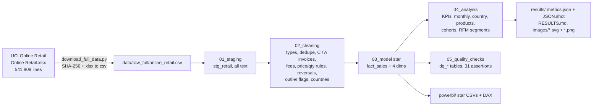

# da-learn-16 · Online retail RFM segmentation (UCI Online Retail)

A data-analyst learning project on the **UCI Online Retail dataset**: every transaction of a UK-based online gift retailer (many customers are wholesalers) from **2010-12-01 to 2011-12-09**, **541,909 invoice lines** in 8 columns. The raw lines go through SQL staging, cleaning (exact duplicates, `C` cancellations, `A` bad-debt adjustments, postage / fee / voucher codes, zero and negative quantities and prices, missing CustomerID, sales reversed by a credit note, outlier flags, country standardisation), a star schema, analysis (revenue KPIs, monthly trend, country mix, product top-N and concentration, monthly cohort retention and **RFM segmentation with R/F/M quintile scores and named segments**) and quality checks. DuckDB runs the whole pipeline locally on the **full** file. The outputs are a Power BI kit plus SVG and PNG charts in `results/images/`.

> **Databricks was skipped** for this project because the Databricks workspace hit its resource quota. There is no live Lakeview dashboard. The SQL stays Databricks/Spark-compatible (the DuckDB shims are isolated in `sql/00`), and all charts and KPIs are in [`results/`](results/RESULTS.md).


## Business questions
1. How big is the business and how seasonal is it (net revenue, orders, average order value by month)?
2. Who are the customers? Which RFM segments carry the revenue, and which valuable customers are slipping away?
3. Do new customers come back (monthly cohort retention)?
4. How much depends on the UK, and which foreign markets matter?
5. How concentrated is revenue across products, and which products are returned?
6. When do orders arrive (weekday × hour)?
7. How dirty is the raw feed (duplicates, cancellations, fees, missing customers, order-entry mistakes)?

## Pipeline


## Headline insights (full data: 519,828 net sales lines, 19,693 orders, 4,324 identified customers)
- **Size and seasonality:** net merchandise revenue was **£9.86M** (£9,861,383.75) from 19,693 orders, an average order value of **£500.76** (median £300.88, 26.4 lines per order). **November 2011 is the peak at £1.44M**, 2.9× February 2011 (£504k), and September–November 2011 bring 35.8% of all revenue. 65.29% of identified customers ordered more than once.
- **RFM: Champions are 23.2% of customers but 66.44% of revenue.** 1,003 Champions (R≥4, F≥4) placed 10.7 orders and spent £5,532 each, last ordering 13 days before the snapshot on average. With Loyal customers added, 36.9% of customers bring 79.4% of revenue. Hibernating + Lost are 31.3% of customers but only 7.98% of revenue.
- **Win-back target:** "Cannot lose them" (148 customers, 5.9 orders and £2,310 each, silent for ~120 days) and "At risk" (248 customers, 3.4 orders, ~141 days) hold **£566k (6.78% of identified revenue)**.
- **Retention:** only **22.6% of a cohort buys again in month 1** (19.0% for genuinely new cohorts, i.e. without December 2010). After that the curve is flat at 21.1–24.0% (M2–M10, new cohorts only), so the customers who come back keep coming back. The Dec-2010 cohort retains far better (M1 36.6%) because the extract starts then and it contains the existing customer base.
- **Countries and products:** the UK takes **84.77%** of revenue. The Netherlands (£283k) comes from just 9 customers at an AOV of £3,048, and Ireland (EIRE, £262k) from 3, against a UK AOV of £469. The top 20% of the 3,794 products bring 77.85% of revenue and the bottom half only 4.23%, but no single item dominates (top 10 = 8.18%; Regency Cakestand 3 Tier is #1 with £170k).
- **Data quality:** 22,081 of 541,909 raw lines (4.07%) are not net sales: 5,268 exact duplicates, 9,288 cancellation lines (kept separately as returns), 2,950 postage/fee/voucher lines, 2,517 zero-price lines, 1,336 stock write-offs, 3 bad-debt adjustments, and **2,709 sales lines exactly reversed by a credit note**. These include two order-entry mistakes worth £245k (80,995 × Paper Craft Little Birdie and 74,215 × Medium Ceramic Top Storage Jar, each cancelled minutes later). 24.93% of raw lines have no CustomerID; they stay in revenue as guest sales (15.31% of revenue) but are excluded from RFM and cohorts. All **31/31 assertions pass**.

More tables and every chart: [`results/RESULTS.md`](results/RESULTS.md).

## Charts
All charts are in `results/images/` as SVG (plain vector shapes, no embedded raster) and PNG (2× headless-Chrome render of the same SVG).

| | |
|---|---|
|  |  |
|  |  |
|  |  |
|  |  |
|  |  |
|  |  |

## How to run
```bash
pip install -r requirements.txt
python run_pipeline.py --source sample       # committed 21,303-line raw sample in data/raw/, results in results/sample/
python scripts/download_full_data.py         # 23.7 MB UCI zip -> data/raw_full/online_retail.csv (SHA-256 checked, ~20 s)
python run_pipeline.py --source full         # full data (~5 s): results/, data/clean/, powerbi/data/, RESULTS.md
python scripts/render_png.py                 # results/images/*.svg -> *.png with headless Chrome
```
`scripts/make_sample.py` rebuilds the committed sample from the full file. The runner stops with an error if any assertion fails.

## Method notes
- **Revenue** = quantity × unit price (GBP) on valid product sales lines. Postage (`POST`, `DOT`, `C2`), fees (`BANK CHARGES`, `AMAZONFEE`, `CRUK`), manual adjustments (`M`), discounts (`D`), samples (`S`), bad debt (`B`), `PADS` and gift vouchers are excluded.
- **Reversals:** a sales line is netted out when a credit note for the same customer, stock code, quantity and price follows it (the k-th sale is paired with the k-th credit note, and the credit note must not be earlier). Other credit notes are reported as returns (`cln_returns`, £475,901 = 4.64% of gross sales).
- **Outliers** are flagged, not removed: quantity or line revenue above Q3 + 1.5 IQR (`is_qty_outlier`, `is_revenue_outlier`), and line revenue above the 99.9th percentile (`is_extreme_line`; the largest are listed in `a_extreme_lines`).
- **RFM:** snapshot 2011-12-10 (the day after the last invoice). R = days since the last order, F = distinct orders, M = net revenue. Each is scored 1–5 with **tie-aware quintiles** (`1 + floor(5 × (rank − 1) / n)` with `RANK()`), so equal values always share a score. Segments (first match wins): Champions R≥4 & F≥4 · Loyal R≥3 & F≥3 · Potential loyalist R≥4 & F=2 · New customers R≥4 & F=1 · Needs attention R=3 · Cannot lose them R≤2 & F≥4 & M≥4 · At risk R≤2 & F≥3 · Hibernating R=2 · Lost R=1.
- **Cohorts:** cohort = month of the first net purchase; retention at offset N = share of the cohort that bought in month cohort + N; the curve is size-weighted over the cohorts observable at each offset.

## Repo layout
```
data/raw/            21,303-line raw sample (byte-for-byte lines; every cleaning rule exercised); full file via scripts/download_full_data.py
data/clean/          customers_rfm.csv (all 4,324 customers, full) + sales_lines_sample.csv (cleaned lines, ~10% of orders)
sql/                 00 DuckDB shims, 01 staging, 02 cleaning, 03 star model, 04 analysis (KPIs, cohorts, RFM), 05 quality checks
run_pipeline.py      DuckDB runner (sample | full)
scripts/             project config, downloader, sample builder, SVG chart writer, PNG renderer, RESULTS.md writer
results/             RESULTS.md, metrics.json, JSON.shot, tables/*.csv, images/*.svg + *.png (dashboard = overview), sample/
powerbi/             star CSVs (full dims + RFM, ~10% fact sample), measures.dax, model.md, dashboard_spec.md, BUILD_GUIDE.md
```

## Caveats
- **Censoring at both ends.** December 2010 is the start of the extract, so its "new" customers include long-standing ones (883 of them). December 2011 stops on the 9th (8 trading days, £445k). Late cohorts have only a few months to return, and offsets M11–M12 rest on one or two cohorts (the M11 spike reflects the November 2011 peak).
- **Guest revenue** (no CustomerID, 15.31% of revenue) is counted in revenue, country and product totals but not in customer counts, RFM or cohorts.
- **Wholesale mix.** Many customers are wholesalers, so AOVs are high and a handful of accounts can dominate a country (Ireland: 3 customers) or a segment (the top customer spent £278,778).
- RFM segment boundaries are a common convention, not a model; the cut-offs behind every score are in `results/tables/a_rfm_score_ranges.csv`. Frequency is skewed (1,501 customers ordered once), so F1 holds more than a fifth of customers.
- Prices are in GBP and are not adjusted for inflation. No cost or margin data is available, so "value" means revenue.
- Medians and percentiles are exact on DuckDB (`quantile_cont`); Spark's `percentile_approx` can differ slightly.
- This is the original **Online Retail** (UCI 352, one year). The larger **Online Retail II** (UCI 502, Dec 2009 – Dec 2011, 1,067,371 lines) is a different dataset and was not used.

## Complete dataset
- **Source:** Chen, D. (2015). *Online Retail*. UCI Machine Learning Repository, https://doi.org/10.24432/C5BW33 (dataset page: https://archive.ics.uci.edu/dataset/352/online+retail). Introductory paper: Chen, Sain and Guo (2012), "Data mining for the online retail industry: A case study of RFM model-based customer segmentation using data mining", *Journal of Database Marketing and Customer Strategy Management* 19(3).
- **Kaggle page:** https://www.kaggle.com/datasets/carrie1/ecommerce-data ("E-Commerce Data", the same 541,909 lines as `data.csv`).
- **Mirror used (exact URL):** https://archive.ics.uci.edu/static/public/352/online+retail.zip
- **Licence:** Creative Commons Attribution 4.0 International (CC BY 4.0). Credit: Daqing Chen, London South Bank University, via the UCI Machine Learning Repository.
- **Total size:** 23,715,478 bytes zipped (SHA-256 `f5385cbb54bbebf7196389109c6b0621faab0c304e3702548165e71c84aede8b`). Inside is `Online Retail.xlsx` (23,715,344 bytes, one sheet). Converted to CSV it is 47,226,068 bytes.
- **Files:** `online+retail.zip` → `Online Retail.xlsx` → `data/raw_full/online_retail.csv`: 541,909 rows × 8 columns (`InvoiceNo, StockCode, Description, Quantity, InvoiceDate, UnitPrice, CustomerID, Country`), 25,900 invoices, 4,372 CustomerIDs, 4,070 stock codes, 38 countries.
- **Download:** `python scripts/download_full_data.py` (downloads the UCI zip, verifies SHA-256 and converts the workbook to `data/raw_full/online_retail.csv`; needs `openpyxl`).
