# Results - da-learn-16 Online retail RFM (UCI Online Retail)

Run: `python run_pipeline.py --source full` on DuckDB 1.5.6 (local, full file: 541,909 raw invoice lines → 519,828 net sales lines, 19,693 orders, 4,324 identified customers). Databricks was skipped because the workspace hit its resource quota, so there is no live dashboard; every number below is in `metrics.json` and `tables/`. **Revenue = net merchandise revenue in GBP (quantity × unit price) on valid sales lines, after removing duplicates, cancellations (C-invoices), bad-debt adjustments (A-invoices), postage / fee / voucher codes, zero prices, stock write-offs and sales lines exactly reversed by a credit note.** Guest lines (no CustomerID) count in revenue but not in customer metrics, RFM or cohorts. Quality checks: **31/31 assertions pass**.

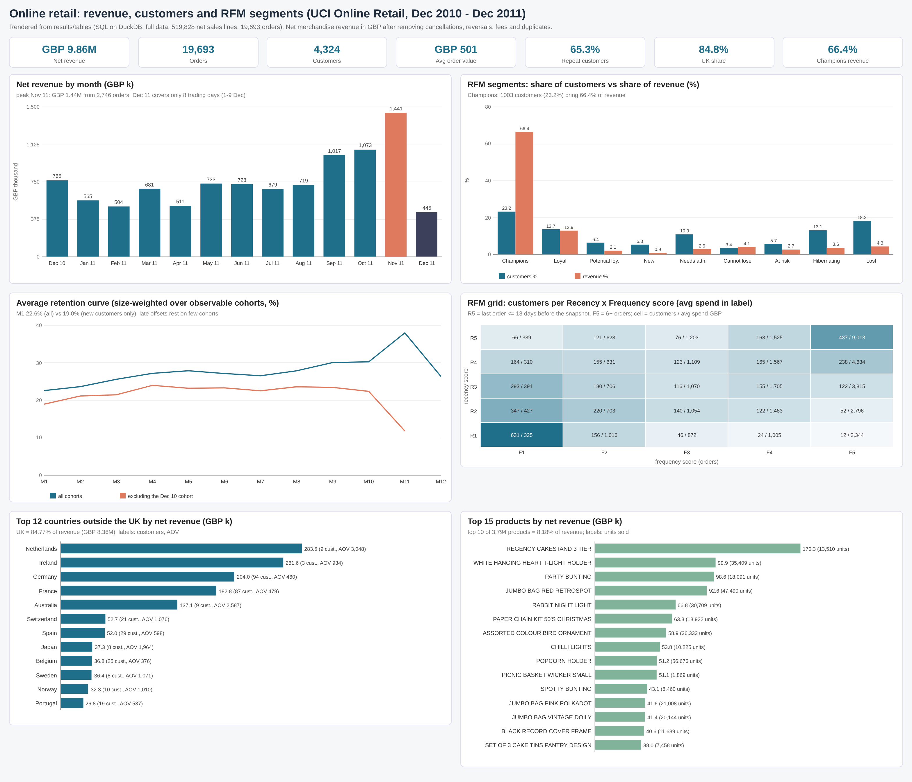

## Headline KPIs
| KPI | Value |
|---|---|
| Period | 2010-12-01 .. 2011-12-09 (13 calendar months, 305 trading days) |
| Net revenue | £9,861,383.75 |
| Gross sales before reversals / reversed value | £10,247,219.32 / £385,835.57 |
| Orders / order lines / units | 19,693 / 519,828 / 5,338,066 |
| Average / median order value | £500.76 / £300.88 |
| Lines per order | 26.40 |
| Identified customers / revenue per customer | 4,324 / £1,931.40 |
| Repeat customers (2+ orders) | 65.29% |
| Guest revenue (no CustomerID) | 15.31% |
| UK share of revenue | 84.77% (38 countries in total) |
| Products sold | 3,794 stock codes |
| Credit-note returns (all C-invoice product lines) | £475,901.16 (4.64% of gross sales) |

## Insights
1. **Strongly seasonal, growing into Q4.** Nov 2011 is the peak at £1,441,295 (2,746 orders, 1,659 active customers), 2.9× February 2011 (£504,220). September to November 2011 alone bring 35.8% of all revenue in the file. December 2011 has only 8 trading days (1-9 Dec), so its £445,449 is not a drop.
2. **RFM: a small core carries the business.** **Champions are 1,003 customers (23.2%) but 66.44% of revenue** (£5,548,929; 10.7 orders and £5,532 each, last order 13 days ago on average). Champions plus Loyal = 36.9% of customers and 79.4% of revenue.
3. **Win-back list.** "Cannot lose them" (148 customers, 5.9 orders and £2,310 each, silent for 120 days) and "At risk" (248 customers, 3.4 orders, 141 days) together hold £566,313 (6.78% of identified revenue). Hibernating + Lost are 31.3% of customers but only 7.98% of revenue.
4. **Retention is low but flat.** Only **22.6%** of a cohort buys again in month 1 (19.0% without the Dec 2010 cohort), and for genuinely new cohorts (excluding Dec 2010) the curve then stays flat between 21.1% and 24.0% from M2 to M10 (all cohorts: M3 25.6%, M6 27.1%), so the customers who come back keep coming back. The Dec 2010 cohort retains far better (M1 36.6%) because the extract starts then and it contains the existing customer base.
5. **UK-centric, with a few big wholesale accounts abroad.** The UK is 84.77% of revenue. Netherlands (£283,480) comes from only 9 customers (AOV £3,048 vs £469 in the UK) and Ireland (EIRE in the raw file, £261,650) from 3.
6. **Long tail of products.** The top 20% of 3,794 products bring 77.85% of revenue and the bottom half only 4.23%, yet no item dominates: the top 10 are 8.18% (#1 Regency Cakestand 3 Tier, £170,280).
7. **Ordering pattern.** 78% of orders start between 10:00 and 15:59, the busiest hour is 12:00 and the busiest day is Thursday; there is no Saturday trading in the file.

## Data quality (before → after)
| entity | row_count | grain |
|---|---|---|
| raw invoice lines (stg_retail) | 541,909 | invoice line |
| after removing exact duplicates | 536,641 | invoice line |
| gross sales lines (before reversals) | 522,537 | invoice line |
| net sales lines (cln_sales = fact_sales) | 519,828 | invoice line |
| net sales lines with a CustomerID | 388,441 | invoice line |
| raw invoices | 25,900 | invoice |
| clean sales orders | 19,693 | invoice |
| returns (credit-note product lines) | 8,668 | invoice line |
| raw distinct CustomerID | 4,372 | customer |
| dim_customer (customers with a net sale) | 4,324 | customer |
| dim_product | 3,794 | stock code |
| dim_date | 305 | trading day |
| dim_country | 38 | country |

Issue counts (flags overlap, so they do not add up to the removed total):

| check_name | affected_rows |
|---|---|
| missing CustomerID (all lines) | 135,080 |
| net sales lines without CustomerID (kept as guest) | 131,387 |
| line revenue above Q3 + 1.5 IQR (flagged, kept) | 40,611 |
| quantity above Q3 + 1.5 IQR (flagged, kept) | 26,737 |
| total raw lines not in net sales | 22,081 |
| cancellation lines, invoice C... (moved to returns) | 9,288 |
| country labels standardised (EIRE, RSA, USA, Unspecified) | 8,991 |
| exact duplicate lines (removed) | 5,268 |
| non-product codes: postage, fees, manual, discounts, samples, vouchers (removed) | 2,950 |
| sales lines exactly reversed by a credit note (removed from net sales) | 2,709 |
| unit price <= 0 (removed) | 2,517 |
| missing description (all lines) | 1,454 |
| quantity <= 0 on a non-C invoice: stock write-offs (removed) | 1,336 |
| line revenue above the 99.9th percentile (flagged, kept; see a_extreme_lines) | 520 |
| bad-debt adjustments, invoice A... (removed) | 3 |

Null rates:

| column_name | raw_missing_pct | clean_missing_pct | treatment |
|---|---|---|---|
| CustomerID | 24.93 | 25.27 | kept as guest revenue (is_guest = 1); excluded from RFM, cohorts and customer counts |
| Description | 0.27 | 0 | all missing descriptions sit on zero-price lines, which are removed; dim_product uses the most frequent description per code |
| any other column | 0 | 0 | no other missing values |

Assertions (31/31 PASS):

| check_name | failed_rows | status |
|---|---|---|
| R, F and M scores all within 1..5 | 0 | PASS |
| RFM covers every identified customer once | 0 | PASS |
| cohort sizes sum to dim_customer | 0 | PASS |
| country exists in dim_country | 0 | PASS |
| country revenue sums to total revenue | 0 | PASS |
| customer exists in dim_customer | 0 | PASS |
| date exists in dim_date | 0 | PASS |
| dates inside 2010-12-01 .. 2011-12-09 | 0 | PASS |
| dimension keys unique (product, customer, country, date) | 0 | PASS |
| each credit note reverses at most one sales line | 0 | PASS |
| every InvoiceDate parsed | 0 | PASS |
| every Quantity and UnitPrice parsed | 0 | PASS |
| every clean line is in fact_sales | 0 | PASS |
| every customer has a named segment | 0 | PASS |
| invoice codes are 6 digits, C+6 or A+6 | 0 | PASS |
| line accounting: gross = net + reversed | 0 | PASS |
| line_revenue = round(quantity x price, 2) | 0 | PASS |
| month-0 retention is 100% for every cohort | 0 | PASS |
| monthly revenue sums to total revenue | 0 | PASS |
| no cancellations or adjustments in fact | 0 | PASS |
| no exact duplicates left in net sales | 0 | PASS |
| no non-product codes in fact | 0 | PASS |
| positive quantity and price in fact | 0 | PASS |
| product exists in dim_product | 0 | PASS |
| product revenue sums to total revenue | 0 | PASS |
| raw rows = flagged rows (nothing dropped while typing) | 0 | PASS |
| returns have positive quantity and value | 0 | PASS |
| reversals happen after the sale | 0 | PASS |
| segment revenue sums to identified-customer revenue | 0 | PASS |
| segment shares sum to 100% (+/- 0.1) | 0 | PASS |
| tie-aware scores: equal values share a score | 0 | PASS |

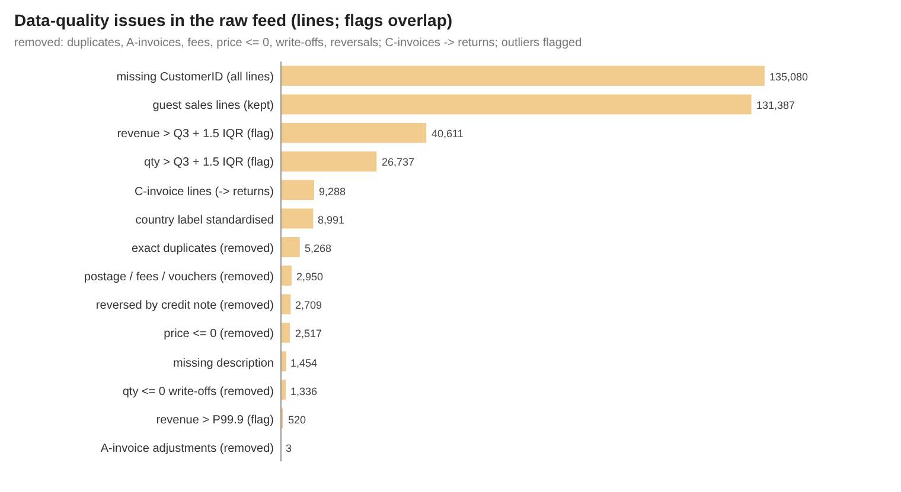

## Monthly trend
| year_month | revenue | orders | active_customers | new_customers | returning_customers | avg_order_value | guest_revenue_pct | revenue_mom_pct | trading_days |
|---|---|---|---|---|---|---|---|---|---|
| 201,012 | 765,302.76 | 1,542 | 883 | 883 | 0 | 496.31 | 27.50 |  | 20 |
| 201,101 | 564,520.29 | 1,075 | 738 | 415 | 323 | 525.14 | 19.08 | -26.24 | 24 |
| 201,102 | 504,219.73 | 1,090 | 756 | 380 | 376 | 462.59 | 12.99 | -10.68 | 24 |
| 201,103 | 680,764.83 | 1,434 | 970 | 450 | 520 | 474.73 | 15.67 | 35.01 | 27 |
| 201,104 | 510,956.90 | 1,229 | 850 | 300 | 550 | 415.75 | 11.93 | -24.94 | 21 |
| 201,105 | 732,861.93 | 1,661 | 1,051 | 283 | 768 | 441.22 | 11.01 | 43.43 | 25 |
| 201,106 | 728,484.46 | 1,517 | 989 | 243 | 746 | 480.21 | 11.57 | -0.60 | 26 |
| 201,107 | 678,593.91 | 1,447 | 946 | 187 | 759 | 468.97 | 14.24 | -6.85 | 26 |
| 201,108 | 718,828.66 | 1,336 | 933 | 169 | 764 | 538.05 | 12.34 | 5.93 | 26 |
| 201,109 | 1,017,287.17 | 1,811 | 1,256 | 296 | 960 | 561.73 | 8.80 | 41.52 | 26 |
| 201,110 | 1,072,819.13 | 1,992 | 1,358 | 356 | 1,002 | 538.56 | 9.41 | 5.46 | 26 |
| 201,111 | 1,441,294.88 | 2,746 | 1,659 | 322 | 1,337 | 524.87 | 21.90 | 34.35 | 26 |
| 201,112 | 445,449.10 | 813 | 612 | 40 | 572 | 547.91 | 22.96 | -69.09 | 8 |

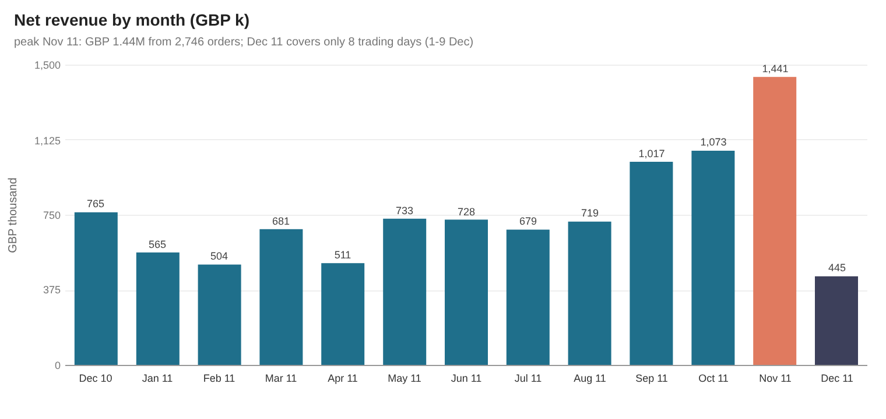
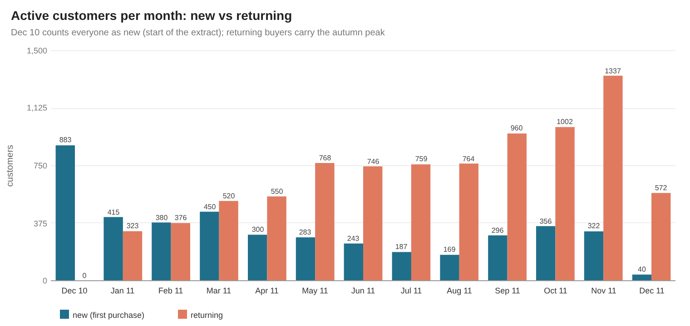
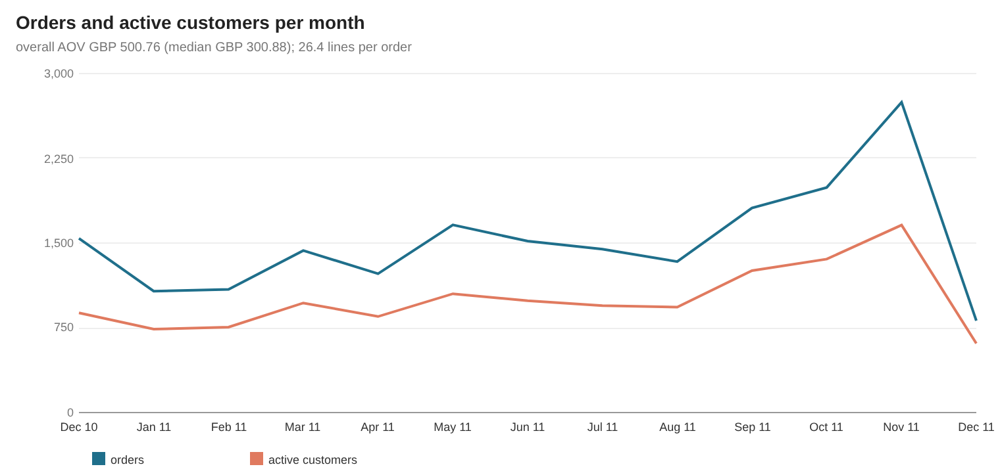
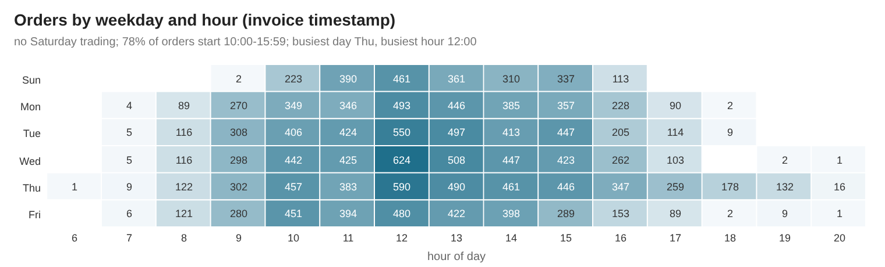

## RFM segmentation
Snapshot 2011-12-10 (the day after the last invoice). R = days since the last order, F = distinct orders, M = net revenue. Scores are **tie-aware quintiles** (`1 + floor(5 × (rank − 1) / n)` with `RANK()`), so customers with equal values always share a score; because 1,501 customers ordered once, F1 is larger than a fifth. Segment rules (first match wins): Champions R≥4 & F≥4; Loyal R≥3 & F≥3; Potential loyalist R≥4 & F=2; New customers R≥4 & F=1; Needs attention R=3; Cannot lose them R≤2 & F≥4 & M≥4; At risk R≤2 & F≥3; Hibernating R=2; Lost R=1.

| segment | customers | customer_share_pct | revenue | revenue_share_pct | avg_recency_days | avg_frequency | avg_monetary | median_monetary |
|---|---|---|---|---|---|---|---|---|
| 01 Champions | 1,003 | 23.20 | 5,548,928.85 | 66.44 | 12.80 | 10.73 | 5,532.33 | 2,428.53 |
| 02 Loyal | 592 | 13.69 | 1,081,602.99 | 12.95 | 38 | 4.52 | 1,827.03 | 1,186.93 |
| 03 Potential loyalist | 276 | 6.38 | 173,219.05 | 2.07 | 16.20 | 2 | 627.61 | 500.04 |
| 04 New customers | 230 | 5.32 | 73,124.17 | 0.88 | 19 | 1 | 317.93 | 228.15 |
| 05 Needs attention | 473 | 10.94 | 241,842.33 | 2.90 | 52.10 | 1.38 | 511.29 | 361.96 |
| 06 Cannot lose them | 148 | 3.42 | 341,905.69 | 4.09 | 120.50 | 5.89 | 2,310.17 | 1,809.34 |
| 07 At risk | 248 | 5.74 | 224,407.72 | 2.69 | 140.60 | 3.40 | 904.87 | 683.99 |
| 08 Hibernating | 567 | 13.11 | 302,834.85 | 3.63 | 118.20 | 1.39 | 534.10 | 363.79 |
| 09 Lost | 787 | 18.20 | 363,526.42 | 4.35 | 272.90 | 1.20 | 461.91 | 267.08 |

What each score means on this data:

| metric | score | customers | min_value | max_value |
|---|---|---|---|---|
| F frequency (orders) | 1 | 1,501 | 1 | 1 |
| F frequency (orders) | 2 | 832 | 2 | 2 |
| F frequency (orders) | 3 | 501 | 3 | 3 |
| F frequency (orders) | 4 | 629 | 4 | 5 |
| F frequency (orders) | 5 | 861 | 6 | 204 |
| M monetary (GBP) | 1 | 865 | 2.90 | 244.08 |
| M monetary (GBP) | 2 | 865 | 244.10 | 476.88 |
| M monetary (GBP) | 3 | 865 | 477.86 | 916.33 |
| M monetary (GBP) | 4 | 865 | 916.98 | 2,007.40 |
| M monetary (GBP) | 5 | 864 | 2,008.55 | 278,778.02 |
| R recency_days | 1 | 869 | 180 | 374 |
| R recency_days | 2 | 881 | 72 | 179 |
| R recency_days | 3 | 866 | 33 | 71 |
| R recency_days | 4 | 845 | 15 | 32 |
| R recency_days | 5 | 863 | 1 | 13 |

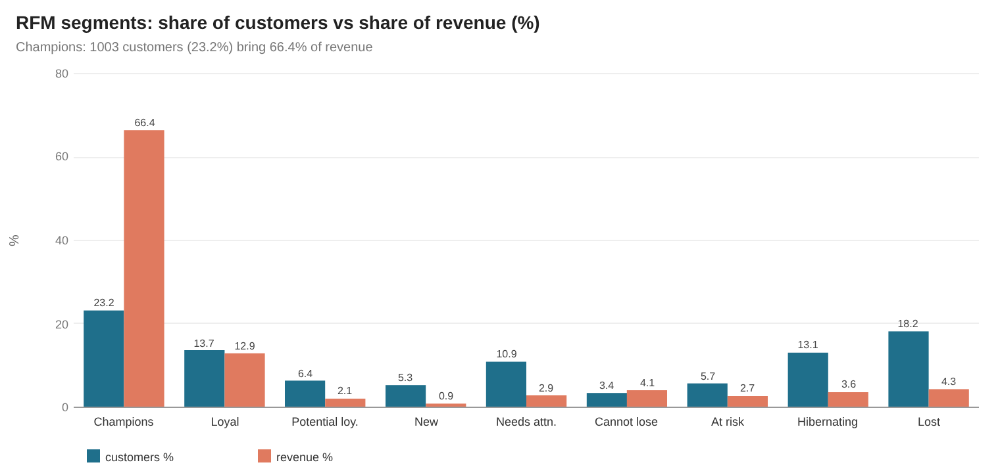
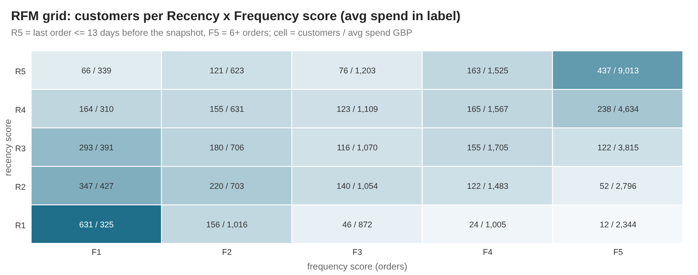

## Cohort retention
Cohort = month of the first net purchase. Retention at offset N = share of the cohort with a purchase in calendar month cohort + N. The curve is size-weighted over the cohorts that can be observed at each offset (late offsets rest on few cohorts; M11-M12 include only the first one or two).

| months_since | cohorts | eligible_customers | active_customers | retention_pct | retention_ex_first_cohort_pct |
|---|---|---|---|---|---|
| 0 | 13 | 4,324 | 4,324 | 100 | 100 |
| 1 | 12 | 4,284 | 968 | 22.60 | 18.97 |
| 2 | 11 | 3,962 | 937 | 23.65 | 21.14 |
| 3 | 10 | 3,606 | 923 | 25.60 | 21.48 |
| 4 | 9 | 3,310 | 900 | 27.19 | 23.98 |
| 5 | 8 | 3,141 | 876 | 27.89 | 23.21 |
| 6 | 7 | 2,954 | 802 | 27.15 | 23.32 |
| 7 | 6 | 2,711 | 720 | 26.56 | 22.54 |
| 8 | 5 | 2,428 | 677 | 27.88 | 23.62 |
| 9 | 4 | 2,128 | 640 | 30.08 | 23.45 |
| 10 | 3 | 1,678 | 508 | 30.27 | 22.39 |
| 11 | 2 | 1,298 | 493 | 37.98 | 11.81 |
| 12 | 1 | 883 | 233 | 26.39 |  |

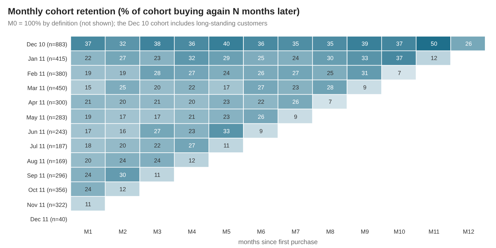
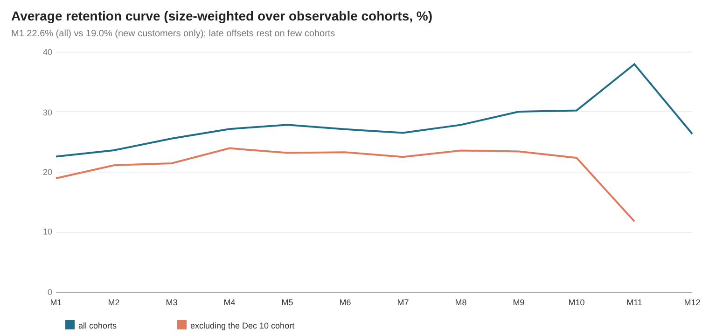

## Countries (top 12 by revenue)
| country | market | revenue | revenue_share_pct | orders | customers | avg_order_value | revenue_per_customer |
|---|---|---|---|---|---|---|---|
| United Kingdom | Domestic (UK) | 8,359,770.09 | 84.77 | 17,831 | 3,909 | 468.83 | 2,138.60 |
| Netherlands | International | 283,479.54 | 2.87 | 93 | 9 | 3,048.17 | 31,497.73 |
| Ireland | International | 261,649.81 | 2.65 | 280 | 3 | 934.46 | 87,216.60 |
| Germany | International | 203,961.43 | 2.07 | 443 | 94 | 460.41 | 2,169.80 |
| France | International | 182,834.59 | 1.85 | 382 | 87 | 478.62 | 2,101.55 |
| Australia | International | 137,124.05 | 1.39 | 53 | 9 | 2,587.25 | 15,236.01 |
| Switzerland | International | 52,717.45 | 0.53 | 49 | 21 | 1,075.87 | 2,510.35 |
| Spain | International | 52,029.97 | 0.53 | 87 | 29 | 598.05 | 1,794.14 |
| Japan | International | 37,314.37 | 0.38 | 19 | 8 | 1,963.91 | 4,664.30 |
| Belgium | International | 36,813.69 | 0.37 | 98 | 25 | 375.65 | 1,472.55 |
| Sweden | International | 36,410.83 | 0.37 | 34 | 8 | 1,070.91 | 4,551.35 |
| Norway | International | 32,319.31 | 0.33 | 32 | 10 | 1,009.98 | 3,231.93 |

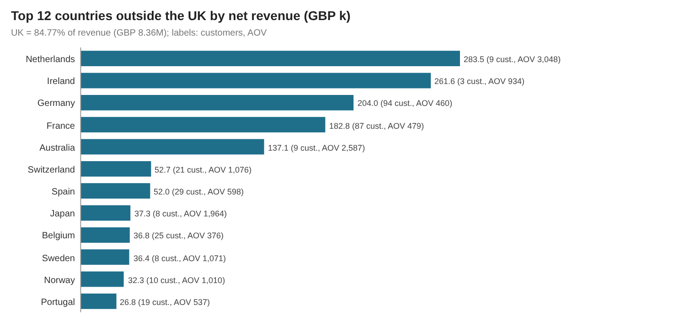

## Products
Concentration: top 10 = 8.18%, top 100 = 31.56%, top 20% of products = 77.85%, top 5% = 44.21%, bottom 50% = 4.23% of revenue.

| revenue_rank | stock_code | description | revenue | revenue_share_pct | units | orders | customers |
|---|---|---|---|---|---|---|---|
| 1 | 22,423 | REGENCY CAKESTAND 3 TIER | 170,280.39 | 1.73 | 13,510 | 1,948 | 873 |
| 2 | 85123A | WHITE HANGING HEART T-LIGHT HOLDER | 99,941.43 | 1.01 | 35,409 | 2,253 | 854 |
| 3 | 47,566 | PARTY BUNTING | 98,614.83 | 1 | 18,091 | 1,675 | 708 |
| 4 | 85099B | JUMBO BAG RED RETROSPOT | 92,601.23 | 0.94 | 47,490 | 2,078 | 633 |
| 5 | 23,084 | RABBIT NIGHT LIGHT | 66,807.63 | 0.68 | 30,709 | 991 | 449 |
| 6 | 22,086 | PAPER CHAIN KIT 50'S CHRISTMAS | 63,834.94 | 0.65 | 18,922 | 1,152 | 611 |
| 7 | 84,879 | ASSORTED COLOUR BIRD ORNAMENT | 58,878.61 | 0.60 | 36,333 | 1,452 | 677 |
| 8 | 79,321 | CHILLI LIGHTS | 53,761.61 | 0.55 | 10,225 | 658 | 204 |
| 9 | 22,197 | POPCORN HOLDER | 51,171.77 | 0.52 | 56,676 | 1,389 | 406 |
| 10 | 22,502 | PICNIC BASKET WICKER SMALL | 51,064.17 | 0.52 | 1,869 | 460 | 174 |
| 11 | 23,298 | SPOTTY BUNTING | 43,118.48 | 0.44 | 8,460 | 1,145 | 573 |
| 12 | 22,386 | JUMBO BAG PINK POLKADOT | 41,615.71 | 0.42 | 21,008 | 1,212 | 370 |
| 13 | 23,203 | JUMBO BAG VINTAGE DOILY | 41,413.86 | 0.42 | 20,144 | 1,226 | 504 |
| 14 | 21,137 | BLACK RECORD COVER FRAME | 40,588.38 | 0.41 | 11,639 | 372 | 139 |
| 15 | 22,720 | SET OF 3 CAKE TINS PANTRY DESIGN | 37,985.14 | 0.39 | 7,458 | 1,374 | 635 |

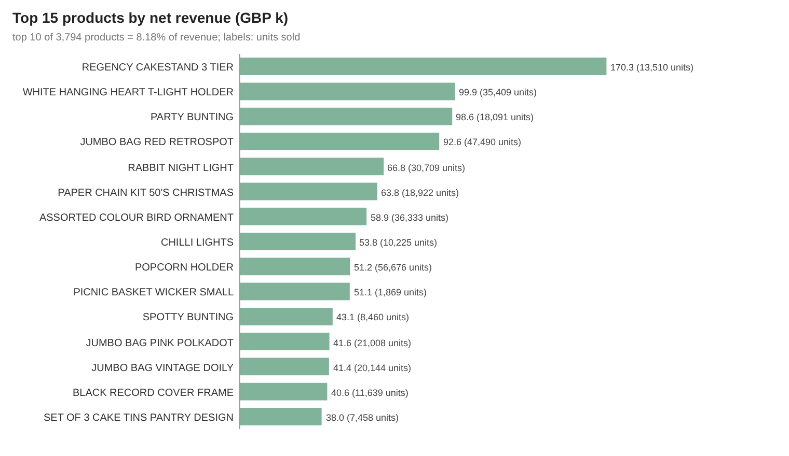
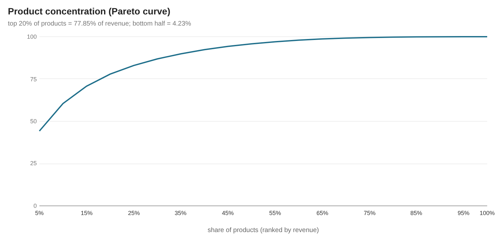

Most-returned products by value (credit notes; the top lines include the two giant order-entry mistakes that were reversed):

| stock_code | description | return_value | units_returned | credit_notes |
|---|---|---|---|---|
| 23,843 | PAPER CRAFT , LITTLE BIRDIE | 168,469.60 | 80,995 | 1 |
| 23,166 | MEDIUM CERAMIC TOP STORAGE JAR | 77,479.64 | 74,494 | 10 |
| 22,423 | REGENCY CAKESTAND 3 TIER | 9,697.05 | 855 | 180 |
| 85123A | WHITE HANGING HEART T-LIGHT HOLDER | 6,624.30 | 2,578 | 42 |
| 21,108 | FAIRY CAKE FLANNEL ASSORTED COLOUR | 6,591.42 | 3,150 | 3 |
| 23,113 | PANTRY CHOPPING BOARD | 4,803.06 | 946 | 6 |
| 48,185 | DOORMAT FAIRY CAKE | 4,554.90 | 674 | 3 |
| 21,175 | GIN + TONIC DIET METAL SIGN | 3,775.33 | 2,030 | 7 |

Largest single lines kept after reversal netting (flagged `is_extreme_line`, above the 99.9th percentile of line revenue):

| invoice | invoice_date | customer_id | stock_code | description | country | quantity | unit_price | line_revenue |
|---|---|---|---|---|---|---|---|---|
| 556,444 | 2011-06-10 | 15,098 | 22,502 | PICNIC BASKET WICKER SMALL | United Kingdom | 60 | 649.50 | 38,970 |
| 567,423 | 2011-09-20 | 17,450 | 23,243 | SET OF TEA COFFEE SUGAR TINS PANTRY | United Kingdom | 1,412 | 5.06 | 7,144.72 |
| 550,461 | 2011-04-18 | 15,749 | 21,108 | FAIRY CAKE FLANNEL ASSORTED COLOUR | United Kingdom | 3,114 | 2.10 | 6,539.40 |
| 573,003 | 2011-10-27 | 14,646 | 23,084 | RABBIT NIGHT LIGHT | Netherlands | 2,400 | 2.08 | 4,992 |
| 576,365 | 2011-11-14 |  | 22,086 | PAPER CHAIN KIT 50'S CHRISTMAS | United Kingdom | 688 | 6.95 | 4,781.60 |
| 550,461 | 2011-04-18 | 15,749 | 85123A | WHITE HANGING HEART T-LIGHT HOLDER | United Kingdom | 1,930 | 2.40 | 4,632 |
| 558,526 | 2011-06-30 | 17,949 | 23,173 | REGENCY TEAPOT ROSES | United Kingdom | 540 | 8.15 | 4,401 |
| 550,461 | 2011-04-18 | 15,749 | 48,185 | DOORMAT FAIRY CAKE | United Kingdom | 670 | 6.35 | 4,254.50 |

## Files
- `metrics.json`: KPIs, data-quality counts and assertions, engine versions and SQL timings.
- `JSON.shot`: headline snapshot (KPIs, RFM segments, countries, products, retention, config). Valid JSON.
- `tables/*.csv`: every `a_*` analysis table and `dq_*` quality table from the full run.
- `images/*.svg` (plain vector shapes, no embedded raster) and `images/*.png` (2× headless-Chrome renders of the same SVGs).
- `sample/`: the same outputs from the committed raw sample (`--source sample`) - small numbers, for smoke-testing only.
